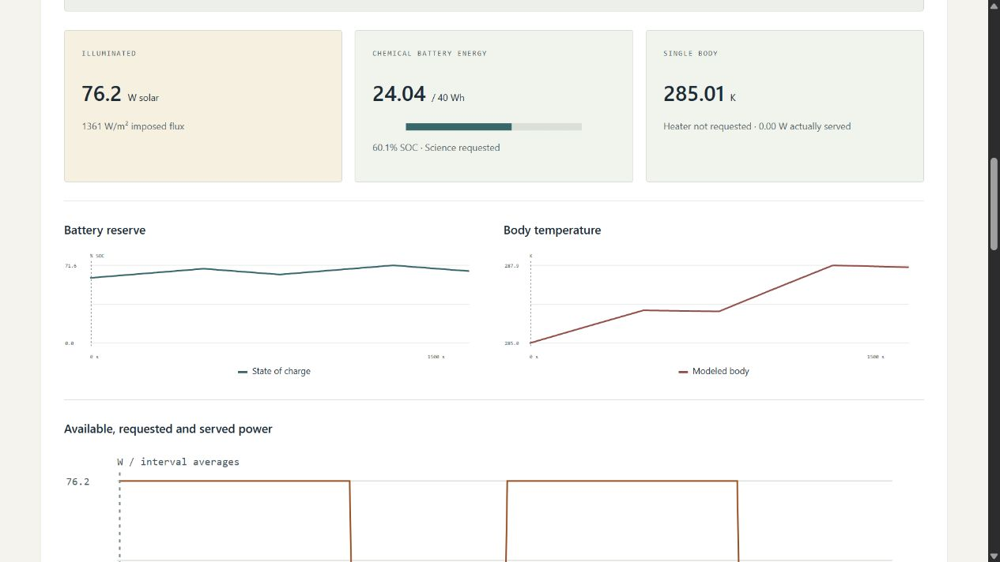

# Spacecraft Power Thermal Lab

**Every watt becomes a trade-off.** An offline scientific-computing workbench by [Jason Stys](https://github.com/JasonStys).

Explore a fictional spacecraft's solar generation, battery reserve, electrical-load priorities and thermal response through imposed light/dark profiles. A **C++20** worker computes bounded power allocation and a single-node RK4 thermal model. An independently structured **Python** implementation checks **every numerical sample**, then separately audits the electrical and thermal energy ledgers. **TypeScript, HTML, CSS and SVG** provide an accessible replay; **SQL/SQLite** provides optional local immutable evidence history.

All spacecraft parameters and environmental profiles are invented. This is **educational numerical verification, not measured telemetry, orbital eclipse prediction, validated battery design, hardware control or flight-qualified analysis**. Read the [model and limits](docs/MODEL.md) before interpreting results.



## Features

- Nine experiments: illumination cycles, prolonged darkness, payload surges, cold/hot cases, empty/full batteries, analytic cooling and heater power contention.
- Finite battery, load-policy, thermostat and timestep controls; 324 combinations exercised against the actual C++ worker and independent Python reference.
- Charge/discharge limits, chemical-to-bus efficiency, explicit conversion losses, saturation, spill, and unmet demand. Housekeeping is served before heater, then science.
- Hysteretic reserve-aware science shedding and heater requests. **Intentional science shedding is separate from unserved requested energy**; a requested heater may receive less than its nominal power.
- Kelvin-based lumped-body integration, fixed ideal radiative sink, explicit heat fractions and separate external array/body assumptions. Sampling and physical-model limits stay visible.
- Interval replay, all-sample state/power plots, Celsius display without changing SI evidence, exact selected-interval allocation, and an in-memory pinned-result comparison.
- Complete JSON/escaped static HTML evidence, dimensioned interval CSV, editable strict input JSON, content hashes, and opt-in SQL history. No automatic payload collection, accounts or remote services.
- Cross-platform warning-as-error C++ builds, Clang ASan/UBSan, GCC line coverage, Python/TypeScript tests, three browser engines, dependency audits and three-language CodeQL.

## Run a portable desktop bundle

Use [Releases](https://github.com/JasonStys/spacecraft-power-thermal-lab/releases/latest). Download the ZIP for your OS/architecture and its `.sha256` file, verify the digest, and extract the **entire** `SpacecraftPowerThermalLab` folder. Keep `_internal` and license files intact; don't launch from inside the ZIP.

- Windows x64: open `SpacecraftPowerThermalLab.exe`.
- Linux x64: run `./SpacecraftPowerThermalLab`; restore executable permission with `chmod +x` if ZIP extraction did not preserve it.
- macOS arm64: run `./SpacecraftPowerThermalLab` from Terminal.

The executable opens your normal browser on an ephemeral `127.0.0.1` port. Keep its console running; Ctrl+C stops it. No Python/Node/compiler installation, administrator rights, account or cloud connection is needed for the bundled app. These are **unsigned/unnotarized portable desktop applications**, not mobile installers or public hosted services. Do not bypass OS security warnings; inspect/build source if your policy disallows unsigned software.

## Source setup

Requires Python 3.12–3.14, Node 24, and a C++20 compiler: Visual Studio 2022/2026 C++ tools on Windows, GCC/Clang on Linux or Apple Clang on macOS. The development lock installs CMake; Python runtime and C++ model use only their standard libraries.

```powershell
python -m venv .venv
.venv/Scripts/python -m pip install --require-hashes -r requirements-dev.lock
npm ci
.venv/Scripts/python tools/build_native.py
npm run build
.venv/Scripts/python -m powerlab serve
```

Use `.venv/bin/python` on Linux/macOS. Windows builds need the installed SDK's normal registry access; don't weaken OS security settings. If your execution sandbox restricts temporary files, use a task-owned writable TEMP/TMP directory. The native worker is mandatory: a missing worker never causes a reference-only success fallback.

## Export or customize

```powershell
.venv/Scripts/python -m powerlab export --scenario extended-eclipse --policy 1 --output reserve.json --history history.sqlite3
.venv/Scripts/python -m powerlab export --input examples/illumination.json --format html --output custom.html
```

Existing output destinations are never overwritten. CLI imports accept only the bounded [schema](docs/API.md), not executable code or device/network addresses. Imported battery capacity remains exactly what the file specifies; the browser battery preset does not override it. For imports, `settings.battery` records the unused preset; the **actual value is `input.config.battery_wh`**, which the UI/report exposes. Step/policy/heater controls still apply.

SQLite is optional, unencrypted, local-only and ignored by Git. It verifies report identity, uses immutable-entry triggers and caps at 100 distinct reports without automatic pruning. It is evidence history, not a resume/checkpoint mechanism. Reports include parameters, imposed inputs, numerical methods, units, limits and SHA-256 identities. Floating-point reports can differ slightly across compilers; benchmark metrics use declared tolerances, not an unsupported universal bit-identical claim.

## Check the project

```powershell
.venv/Scripts/python tools/build_native.py
.venv/Scripts/python -m ruff check powerlab tests tools launcher.py
.venv/Scripts/python -m ruff format --check powerlab tests tools launcher.py
.venv/Scripts/python -m mypy powerlab
.venv/Scripts/python tools/verify_repo.py
.venv/Scripts/python -m pytest --cov=powerlab --cov-report=term-missing
.venv/Scripts/python -m tools.benchmark
npm run format:check
npm test
npm run build
npx playwright install chromium firefox webkit
npm run test:e2e
.venv/Scripts/python tools/package_app.py
```

Linux additionally runs `tools/build_native.py --sanitize` with Clang, and `--coverage` with GCC, followed by the integration tests and gcovr. These are distinct builds; sanitizers and coverage are not claimed to have run under Windows. See [executed results and test strategy](docs/VALIDATION.md).

GitHub workflows upload **no Actions artifacts or caches**. Portable releases are built, smoke-tested and uploaded directly to a draft release only after the exact source commit's Validation and CodeQL workflows pass. A separate review checks findings, download digests and actual app behavior before publication. No old runs are deleted automatically.

## File and feature map

| Path                                           | Responsibility                                                                             |
| ---------------------------------------------- | ------------------------------------------------------------------------------------------ |
| `native/core.hpp`, `core.cpp`                  | Strict C++ parameter/profile types, allocation, hysteresis, RK4, serialization             |
| `native/cli.cpp`, `tests.cpp`                  | Bounded stdin-only worker and seven analytic/security contract groups                      |
| `powerlab/model.py`, `engine.py`               | Strict JSON/SI inputs, invented cases, sample-agreement and energy gates, report identity  |
| `powerlab/native.py`, `reference.py`           | Fixed native process/timeout contract; independent Python flows and RK4                    |
| `powerlab/server.py`, `__main__.py`            | Protected read-only loopback API, explicit local CLI imports/exports                       |
| `powerlab/reports.py`, `resources/history.sql` | Inert reports and opt-in immutable hash-verified SQL history                               |
| `web/`                                         | Typed scientific presentation, charts, accessible controls, responsive styling             |
| `tests/`                                       | Differential/property/analytic, schema, HTTP, persistence, browser and failure regressions |
| `tools/`                                       | Native builds, exact-line inventory, numerical benchmarks, packaging/smoke/release gates   |
| `examples/`, `docs/`                           | Editable invented profile, methods, results, provenance, screenshots and runbooks          |
| `.github/workflows/`                           | Pinned least-privilege cross-platform validation, CodeQL and manual draft packaging        |

Every source file has a responsibility/creator header and definition contracts. [CODE_INDEX](docs/CODE_INDEX.md) gives generated exact line locations for definitions, fields and variables without fragile duplicated line numbers in comments. [FILE_CATALOG](docs/FILE_CATALOG.md) summarizes every source-intent file; CI rejects stale indexes.

## Documentation, contribution and contact

[Architecture](docs/ARCHITECTURE.md) · [Model/equations](docs/MODEL.md) · [Input/API](docs/API.md) · [User guide](docs/USER_GUIDE.md) · [Validation](docs/VALIDATION.md) · [Release/runbook](docs/RELEASE.md) · [Security](SECURITY.md) · [Notices/references](docs/THIRD_PARTY.md)

For contributions, reproduce an issue with a synthetic case, add the relevant boundary/regression test, update model documentation and inventory, and run the checks above. Don't commit personal data, keys, histories or generated applications. New physical claims require independent validation evidence, not merely updated snapshots.

Created by **Jason Stys**. [Portfolio/contact profile](https://github.com/JasonStys) · [Project help/issues](https://github.com/JasonStys/spacecraft-power-thermal-lab/issues). MIT project source. No agency, employer or mission affiliation/endorsement.
